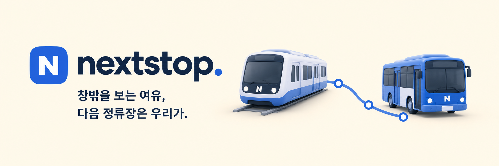
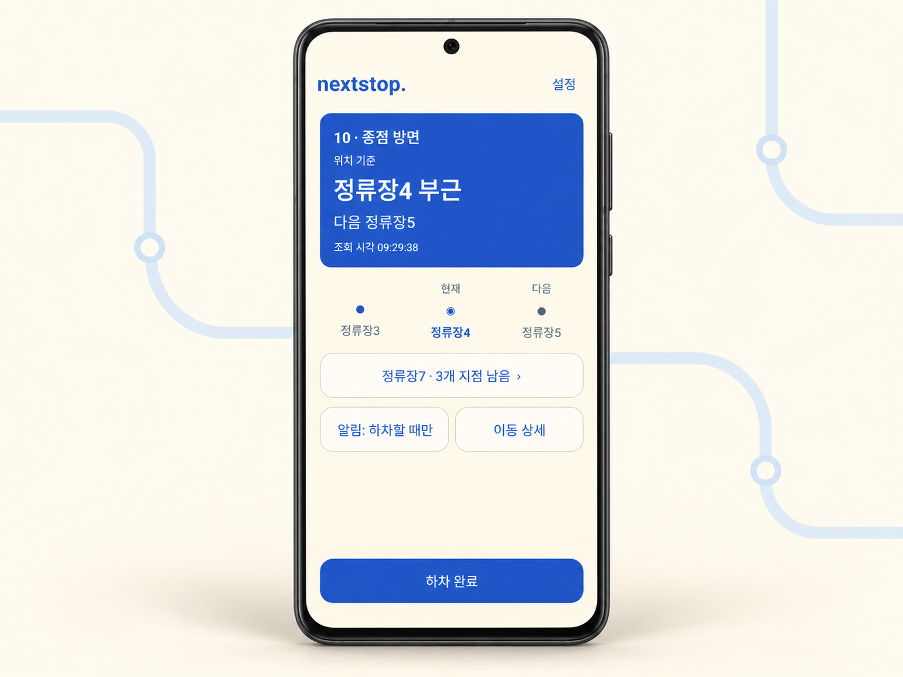

# NextStop

> **창밖을 보는 여유, 다음 정류장은 우리가.**

음악을 듣거나 창밖을 바라보다가, 문득 지금 어디쯤 왔는지 궁금해질 때가 있어요.

NextStop은 **지금 타고 있는 버스·지하철의 이동 상황과 내릴 곳까지 남은 지점**을 알려주는 Android 앱이에요. 내가 탄 차량과 하차 지점을 선택하면 현재 위치와 다음 정차 지점을 확인하고, 하차 안내를 받을 수 있어요.

## 내 이동을 한눈에

지금 어디쯤 왔는지, 다음은 어느 정류장인지, 내릴 곳까지 몇 지점이 남았는지. 이동 중에 궁금한 정보를 한 화면에 모았어요.

주변 노선에서 지나온 길과 앞으로 갈 지점을 살펴보고, 필요할 때는 전체 노선과 안내 기록을 열어볼 수 있어요. 작은 화면이나 큰 글자 설정에서도 현재·다음 위치를 먼저 확인할 수 있도록 구성했어요.

  

예시 데이터를 사용한 Android 앱 화면 목업입니다.

## 앱을 닫아도 이어지는 안내

다른 앱을 사용하는 동안에도 Android 알림에서 현재 이동을 확인할 수 있어요. 하차 지점 직전과 하차 지점에서 안내를 받거나, 각 도착·진행 지점의 안내를 받아보세요. 조용히 이동하고 싶을 때는 무음 갱신으로 위치 표시만 확인할 수도 있어요.

하차 지점과 알림 방식은 이동 중에도 바꿀 수 있어요. 내린 뒤 **하차 완료**를 누르면 차량 조회와 안내가 함께 종료돼요.

## 내가 탄 차부터, 내릴 곳까지

첫 화면의 선택 지도에서 **버스·지하철 아이콘**을 눌러 주세요. 처음 이용할 때는 [연결 안내](docs/android.md#개인-api-키)에 따라 개인 교통 API 키를 등록하면 돼요. 지도는 교통수단을 고르는 개념도이며, 차량과 하차 지점은 실제 정차 순서의 노선도에서 선택해요.

1. **노선을 찾아요.** 버스는 지역과 노선 번호를 선택하고, 지하철은 노선 아이콘을 고른 뒤 운행 열차를 조회해요.
2. **내가 탄 차량을 골라요.** 노선도 위 차량 아이콘에서 차량번호·현재 위치·진행 방향을 확인하고 눌러 주세요.
3. **내릴 곳을 정해요.** 노선도에서 하차 지점을 누르고 알림 방식을 고른 뒤 **이동 추적 시작하기**를 누르면 준비가 끝나요.

주요 버튼은 화면 하단에 있어 목록을 길게 내려 찾을 필요가 없어요. 진행 중인 이동이 있으면 앱을 다시 열었을 때 해당 이동을 먼저 보여줘요.

## 지금 이용할 수 있는 곳

NextStop은 **Android 8.0 이상**에서 사용할 수 있어요. 현재 안내하는 교통수단은 다음과 같아요.

| 교통수단 | 지원 범위 |
| --- | --- |
| 버스 | TAGO 제공 도시 중 정차 순서와 차량 위치를 확인할 수 있는 노선 |
| 지하철 | 서울 1~9호선, 2호선 성수·신정 지선 포함 |
| 광역·경전철 | 경의중앙선·공항철도·경춘선·수인분당선·신분당선·경강선·우이신설선·서해선·신림선·GTX-A |

서울시 공식 역정보를 바탕으로 **19개 노선**을 선택할 수 있어요. 정차 경로를 확인할 수 있는 일반 열차와 **9호선 급행**을 안내해요. 급행에서는 실제 정차역만 하차역으로 고를 수 있고, 남은 역 수와 알림도 정차역을 기준으로 알려드려요. 다른 노선의 급행·특급과 데이터가 제공되지 않는 구간은 아직 지원하지 않아요.

버스는 위치 정보에 따른 **정류장 부근·진행 안내**, 지하철은 **역 진입·도착·출발 상태**를 표시해요. 교통 정보가 지연되거나 차량을 찾을 수 없을 때는 마지막 확인 위치와 상태를 함께 알려줘요.

한 번에 하나의 이동을 최대 4시간 동안 확인할 수 있어요. 네트워크 상태나 Android 실행 제한에 따라 갱신과 알림이 지연될 수 있으며, 추적이 중단되면 앱에서 재개하거나 차량을 다시 선택해 주세요.

## 시작하기

현재 Android 개발 버전으로 제공하고 있어요. 설치와 API 키 발급·등록 방법은 [Android 앱 이용·설치 안내](docs/android.md#실행과-설치)에서 확인할 수 있어요.

개인 API 키는 기기에 암호화해 보관해요. 이동 안내에는 알림 권한이 필요하며, 기기의 위치 권한은 사용하지 않아요.

개발 관련 문서

- [Android 개발 안내](docs/android.md) — 빌드·설치, API 연결, 알림과 검증.
- [개발 명세](docs/development.md) — 사용 흐름, 차량 식별과 추적 상태.
- [UI 디자인 시스템](docs/design-system.md) — 색상, 노선도와 접근성 규칙.
- [디자인 토큰](docs/design-tokens.json) — 색상·간격·글자 크기의 구현 기준.

