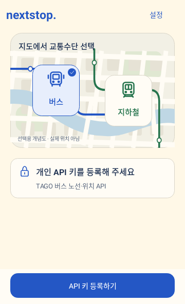
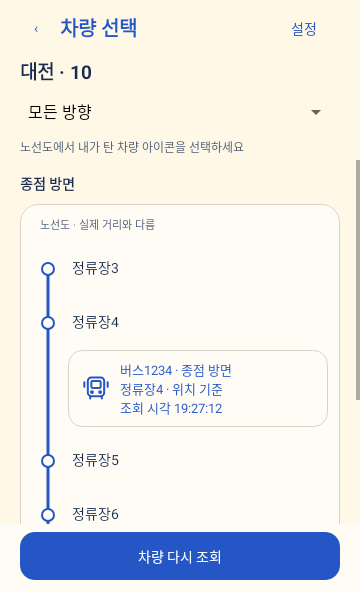
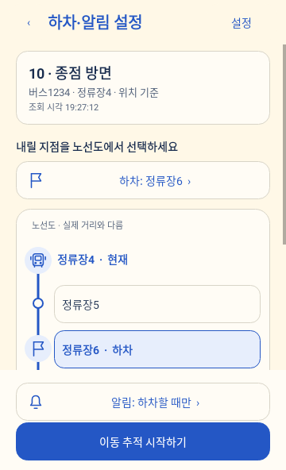

# NextStop Android 개발 안내

Android 앱이 사용자의 개인 API 키로 교통 API를 직접 조회합니다. 백엔드·FCM·공용 인증키 없이 차량 선택, 이동 화면, 지속 알림과 로컬 도착·하차 안내를 제공합니다. 기존 React 웹은 예시 데이터로 화면을 확인하는 별도 미리보기입니다.

## 실행과 설치

Android Studio에서 `android/`를 엽니다. JDK 17, Android SDK 36과 Build Tools 35.0.0을 사용하며 Android 8.0(API 26) 이상에서 설치할 수 있습니다. Gradle Wrapper는 8.14.3, Android Gradle Plugin은 8.12.0, Kotlin은 2.1.20으로 고정했습니다.

SDK 경로는 Android Studio가 만든 `local.properties` 또는 `ANDROID_HOME`으로 지정합니다. `local.properties`는 저장소에 포함하지 않습니다.

```bash
cd android
./gradlew :app:assembleDebug :app:testDebugUnitTest :app:lintDebug
```

디버그 APK는 `android/app/build/outputs/apk/debug/app-debug.apk`입니다. 연결한 테스트 기기에 설치할 때는 다음 명령을 사용합니다.

```bash
adb install -r app/build/outputs/apk/debug/app-debug.apk
```

첫 화면의 선택 지도에서 **버스·지하철 아이콘**을 누릅니다. 해당 공급자의 개인 키가 없으면 등록 버튼을 표시합니다. 앱 상단의 **설정 → 버스 API / 지하철 API**에서도 키를 등록하고 연결을 확인할 수 있습니다. 버스는 제공 도시를 불러온 뒤 노선 번호를 검색하고, 지하철은 19개 노선 중 이용 중인 노선을 아이콘 버튼이나 선택창으로 고른 뒤 운행 열차를 조회합니다. 노선도 위 차량 아이콘을 선택하고 하차 지점을 누른 뒤 하단 고정 버튼으로 추적을 시작합니다.

## 화면과 스크롤

- **노선 찾기 → 차량 선택 → 하차·알림 설정**을 별도 화면으로 표시합니다. 검색 조건과 차량 방향 필터는 목록 위에 고정하고, 검색·새로 조회·추적 시작 버튼은 화면 하단에 고정합니다. 뒤로 가면 검색어·지역·방향과 검색 결과를 유지합니다.
- 교통수단은 도로·강·노선이 그려진 선택 지도 위 아이콘으로 고릅니다. 선택한 아이콘은 체크와 배경·경계로 구분하며, API 키 없이도 버스와 지하철을 바꿀 수 있습니다. 이 지도는 **선택용 개념도**이며 실제 주변 지도·GPS·차량 좌표를 나타내지 않습니다.
- 차량 선택은 정차 순서에 연결된 세로 노선도에서 차량 아이콘을 누릅니다. 방향과 실제 정차 경로가 같은 후보끼리 묶으며, 같은 정류장의 차량도 각각 선택할 수 있습니다. 긴 경로에서 생략한 구간은 점선으로 구분합니다. 차량번호·방향·관측 시각을 함께 확인할 수 있습니다.
- 하차 지점은 노선도의 정류장·역 버튼을 직접 누르거나 하차 선택창에서 고릅니다. 지난 지점과 급행 통과역에는 하차 버튼을 만들지 않습니다. 선택한 하차 지점은 깃발·강조·선택 상태로 표시합니다. 알림 변경과 추적 시작은 하단에 고정합니다.
- 큰 소개 제목과 하단 탭을 제거했습니다. API 키와 조회 간격은 상단 설정에서 열며, 설정의 첫 화면에는 공급자별 키 등록 상태만 표시합니다. 입력창·발급 안내·삭제·서울 HTTP 동의는 해당 공급자 항목 안에 있습니다.
- 저장된 이동이 있으면 이동 화면을 먼저 엽니다. 서비스가 중단된 상태는 마지막 확인 위치와 재개 버튼을 표시하며 자동으로 추적을 시작하지 않습니다.
- 이동 화면에는 현재·다음 위치, 데이터 기준 또는 조회 시각, 선으로 연결된 주변 노선과 차량 아이콘, 하차 지점과 남은 지점 수의 원형 표시를 제공합니다. 원형 선은 해당 정차 경로의 시작부터 하차 지점까지의 정차 순서를 기준으로 하며 거리·시간이나 구간 내 위치를 추정하지 않습니다. 알림 방식은 한 줄 선택창으로 변경합니다. 전체 노선·차량 변경·최근 안내 20개는 **이동 상세**에서 엽니다. 전체 노선도 세로 선과 정차·통과·현재·하차 표시로 구분합니다.
- 폭 400dp 미만 또는 글자 배율 1.3 이상이면 주변 노선을 3개 지점으로 요약하고, 그 외에는 이전 최대 3개·현재·다음 최대 3개를 표시합니다. 큰 글자·긴 이름·오류 설명에서는 본문 스크롤을 허용하며 하단 버튼은 계속 보입니다. 버튼 터치 영역은 최소 48dp입니다.

다음은 실제 교통 응답 대신 테스트용 정류장·차량을 사용한 Android 화면입니다. 시스템 상태 표시줄과 실기기 렌더링은 포함하지 않습니다.

<p>
  
  
  
</p>

## 현재 지원 범위

| 기능 | 구현 범위 |
| --- | --- |
| 버스 | TAGO가 제공하는 도시 목록, 노선 검색, 정차 순서와 차량번호별 위치 조회 |
| 지하철 | 서울시 역정보의 19개 노선 선택, 방향·행선지에 맞는 일반 열차 및 9호선 급행 추적, 2호선 지선 포함 |
| 추적 | 기기당 활성 이동 1개, 개인 키로 Foreground Service 직접 조회 |
| 화면 | 노선 찾기, 차량 선택, 현재 이동과 하차 지점 변경, API 키·조회 간격 설정 |
| 노선도 | 화면에 따라 3개 지점 요약 또는 이전 최대 3개·현재·다음 최대 3개, 상세에서 전체 노선 |
| 시스템 표시 | 같은 알림 ID로 갱신하는 지속 알림, 확장 시 가로 노선도, 큰 글자 설정에서는 텍스트 요약 |
| 안내 | 모든 도착·진행 지점, 하차 직전·하차 지점, 무음 갱신 |
| 저장 | 암호화한 개인 키, 활성 이동과 최근 안내 20개, 조회 간격·서울 HTTP 연결 선택 |

전체 전국 버스·지하철의 실시간 추적을 제공하는 단계는 아닙니다. TAGO 목록에 없거나 차량 위치·정차 순서가 일치하지 않는 노선은 추적하지 않습니다. 서울·경기 전용 버스 API, 목록 외 도시철도, 9호선 급행 외의 급행·특급, 시간표 안내, GPS 추정과 iOS는 후속 범위입니다. 즐겨찾기·최근 선택·다크 모드는 React 미리보기에만 구현되어 있습니다.

TAGO 버스 위치는 차량번호·정류소 순번·이름을 제공하지만 정류장 도착 상태를 제공하지 않습니다. 버스 위치는 ‘정류장 부근’, 안내는 ‘부근으로 이동’으로 표시합니다. 정류소 순번 변경을 실제 정류장 도착 확인으로 표시하지 않습니다. [TAGO 버스 위치 명세](https://www.data.go.kr/data/15098533/openapi.do)

서울 지하철은 노선·운행일·열차번호와 방향을 구분하고 `trainSttus`의 진입·도착·출발·전역 출발을 표시합니다. 노선별로 API를 호출하며, 다른 노선 응답·알 수 없는 역/상태·행선지 경로가 없는 후보는 제외합니다. `directAt=1`인 급행은 검증한 정차 패턴이 있을 때 포함합니다. 추적 도중 행선지나 일반/급행 구분이 바뀌면 마지막 위치와 재선택 안내를 유지합니다. 운행 열차번호는 객차번호나 물리적인 편성번호와 다릅니다. [서울 실시간 지하철 위치정보](https://data.seoul.go.kr/dataList/OA-12601/A/1/datasetView.do)

## 지하철 노선과 역정보

1~9호선, 경의중앙선, 공항철도, 경춘선, 수인분당선, 신분당선, 경강선, 우이신설선, 서해선, 신림선, GTX-A의 19개 노선을 선택할 수 있습니다. 이는 앱의 노선 목록이며, 모든 역·열차에서 실시간 응답이 제공된다는 의미는 아닙니다. 실제 후보는 원천 응답과 방향·행선지에 맞는 경로를 확인한 일반 열차 및 9호선 급행입니다.

역 ID와 이름은 서울특별시 열린데이터광장 [실시간도착 역정보](https://data.seoul.go.kr/dataList/OA-12764/A/1/datasetView.do)의 **실시간도착_역정보(20260902).xlsx**(첨부 57, 696개 역 레코드)를 사용합니다. 출처는 서울특별시이며 공공누리 제1유형에 따라 출처를 표시합니다. 역명이 변경되거나 연장 구간이 개통되면 원본 파일과 경로 연결을 함께 갱신해야 합니다.

같은 호선의 역만 연결하고 환승으로 다른 호선에 넘어가는 경로는 만들지 않습니다. 1호선 구로·광명·서동탄 분기, 2호선 내·외선과 성수·신정 지선, 5호선 강동 분기, 6호선 응암 순환, 경의중앙선 서울역 지선, 공항철도의 추가 역 순서를 구분합니다. 합류역에서 이전 경로를 판단할 수 없으면 지나온 역을 임의로 채우지 않습니다. GTX-A는 확인된 운행 구간을 분리해 연결합니다. [서울시 GTX-A 일정 안내(2026-10-13)](https://mediahub.seoul.go.kr/archives/2019678)

하차역은 해당 열차가 행선지까지 운행하며 실제 정차하는 역에서 선택합니다. 진입·전역 출발 상태에서는 곧 도착할 해당 역도 하차역으로 선택할 수 있으며, 실제 도착 상태가 확인될 때 도착 안내를 생성합니다.

9호선 급행은 김포공항~중앙보훈병원 구간의 공식 급행 정차역 16곳을 양방향으로 지원합니다. 정차역은 `seoul-subway-express.json`에 출처·확인일과 함께 보관하며, 2026-10-15에 [운영사 열차이용안내](https://www.metro9.co.kr/kor/sub01_04.do)와 [역정보](https://www.metro9.co.kr/prog/subwayInfo/kor/sub01_01/view.do)를 대조했습니다. API의 `updnLine`과 행선지에 따라 경로를 선택합니다. 운영사 시간표의 상·하행 명칭을 API 숫자에 따로 대입하지 않습니다.

급행 위치가 사평·등촌 등 통과역으로 수신되는 경우에도 같은 열차의 진행을 계속 추적합니다. 물리적인 역 순서와 `Stop.isScheduledStop`을 함께 저장하고, 하차 목록·다음 정차역·남은 역 수·주변 노선·도착 알림에는 정차역만 반영합니다. 전체 노선에서는 통과역에 ‘통과’를 표시합니다. 하차 직전 알림은 물리적으로 바로 옆 역이 아닌 다음 정차역을 기준으로 한 번만 생성합니다. 다른 노선의 급행과 특급은 검증된 정차 패턴을 추가하기 전까지 후보에서 제외합니다.

원본 XLSX를 내려받은 뒤 저장소 루트에서 다음 명령으로 역정보를 다시 생성합니다. 연결 정보도 운영 노선도와 대조한 뒤 경로 테스트를 실행합니다.

```bash
python3 scripts/import-seoul-subway.py /path/to/실시간도착_역정보.xlsx --date 2026-09-02
cd android
./gradlew :app:testDebugUnitTest --tests kr.nextstop.app.data.SubwayNetworkTest
```

## 개인 API 키

TAGO 키는 공공데이터포털에서 발급받습니다. **버스노선정보와 버스위치정보를 각각 활용 신청**해야 하며, 개인 키 하나를 두 서비스에 사용합니다. Encoding 키와 Decoding 키를 모두 받아 요청 전에 한 번만 인코딩합니다. [버스노선정보](https://www.data.go.kr/data/15098529/openapi.do), [버스위치정보](https://www.data.go.kr/data/15098533/openapi.do)

지하철은 서울 열린데이터광장의 실시간 지하철 위치정보용 개인 인증키를 별도 등록합니다. TAGO 키와 서울 키는 각각 저장·교체·삭제할 수 있습니다. 해당 키를 삭제하면 그 공급자의 활성 추적을 종료합니다.

키는 Android Keystore에서 생성한 AES-GCM 키로 암호화해 앱 전용 SharedPreferences에 보관합니다. 새 암호화마다 다른 IV를 사용합니다. 키 입력 화면은 캡처·자동 완성·View 상태 저장을 막고, 이미 등록한 키를 입력란에 다시 채우지 않습니다. 앱 백업과 기기 이전에서 키·이동 상태를 제외합니다. [Android Keystore](https://developer.android.com/privacy-and-security/keystore), [백업 규칙](https://developer.android.com/about/versions/12/backup-restore)

인증키는 교통 공급자의 API 호출에만 사용합니다. 앱 번들, 이동 저장 상태, 알림, 로그나 분석 SDK에 포함하지 않습니다. 요청 URL이나 공급자 오류 원문을 사용자 오류 메시지로 표시하지 않습니다. 저장값이 손상되거나 복호화되지 않으면 미등록으로 처리하며 평문 저장으로 전환하지 않습니다.

기본 연결은 HTTPS입니다. 서울의 HTTPS 호출이 지원되지 않는 환경에서는 사용자가 API 키 화면의 HTTP 허용을 직접 선택할 수 있습니다. 이 선택은 개인 키가 암호화되지 않은 연결로 전송됨을 화면에 표시하며, 허용 대상은 `swopenapi.seoul.go.kr` 하나로 제한합니다. HTTPS 오류 후 자동으로 HTTP로 전환하지 않습니다.

## 조회와 알림 수명

조회 간격은 기본 30초이며 20·60초를 선택할 수 있습니다. 활성 차량 위치 조회 1회 기준으로 각각 시간당 약 180·120·60회입니다. 도시·노선 검색·정차 순서·연결 확인과 페이지 조회는 추가 호출입니다. 같은 키를 다른 앱에서도 사용하면 해당 키의 한도를 함께 소비합니다.

인증 실패·승인 거부·호출 한도 초과는 추적을 중단합니다. 일시적인 연결 실패는 마지막 위치를 유지하고 재시도 간격을 최대 120초로 늘립니다. 원천 시각이 있는 지하철은 90초를 넘긴 데이터를 최신 위치로 취급하지 않습니다. TAGO는 원천 관측 시각을 제공하지 않으므로 ‘조회 시각’으로 구분합니다.

사용자가 앱에서 추적을 시작하면 `dataSync` Foreground Service를 실행합니다. 알림 권한이 거부되어도 노선 검색은 가능하지만, 앱 밖의 지속 표시를 제공하기 위해 추적 시작에는 알림 허용을 요구합니다. 위치·상시 위치 권한은 사용하지 않습니다.

상태 갱신은 `ride_status` 채널에서 소리 없이 처리하고, 도착·하차·버스 진행 안내는 `ride_alerts` 채널에서 발송합니다. 실제 소리·진동은 Android 채널 설정을 따릅니다. 안내 알림은 최근 3개만 시스템에 유지합니다. 하차역·정류장에 도착했다고 사용자가 실제로 내렸다고 판단하지 않으며 ‘하차 완료’로 종료합니다.

한 세션은 최대 4시간입니다. 하차 완료·키 삭제·Android 서비스 시간 초과 시 종료합니다. 화면을 닫는 것과 앱 강제 종료는 다릅니다. 강제 종료·프로세스 종료·재부팅 후 자동으로 서비스를 재시작하지 않습니다. 만료 전 저장한 이동은 앱에서 명시적으로 재개할 수 있으며, 중단 사유가 있는 이동은 차량을 다시 선택합니다. [서비스 시간 제한](https://developer.android.com/develop/background-work/services/fgs/timeout)

Android가 서비스 실행이나 네트워크를 제한하면 갱신·안내가 지연되거나 누락될 수 있습니다. 30초 조회가 모든 역의 짧은 정차 상태를 포착한다는 의미도 아닙니다. 관측하지 못한 역의 도착 알림을 뒤늦게 만들지 않습니다. 잠금화면·Doze·제조사 정책과 실제 데이터 지연은 실기기 승차 검증이 필요합니다.

## 코드 구성

| 파일 | 역할 |
| --- | --- |
| `MainActivity.kt` | 노선 검색·차량 선택·현재 이동·개인 키 입력, 알림 권한 |
| `ui/TransitVisuals.kt` | 교통수단 선택 지도, 벡터 아이콘, 선택 가능한 세로 노선도, 연결된 주변 노선과 원형 표시 |
| `data/PersonalKeyStore.kt` | Keystore AES-GCM 암호화 저장·삭제·복호화 |
| `data/TransitClient.kt` | 직접 HTTP 요청, 키 인코딩, 목록 페이지 처리 |
| `data/ApiParsers.kt` | TAGO 응답·노선별 서울 열차 상태·시각 정규화 |
| `data/SubwayNetwork.kt` | 방향·행선지별 경로, 분기·지선·순환 및 급행 정차 패턴 처리 |
| `resources/seoul-subway.json` | 서울시 공식 19개 노선·696개 역 레코드와 같은 노선의 연결 정보 |
| `resources/seoul-subway-express.json` | 검증한 9호선 급행 정차역 16곳, 출처와 확인일 |
| `data/SessionStore.kt` | 이동 상태 검증·복원, 조회 간격과 연결 선택 |
| `domain/Models.kt` | 차량·정차 순서·이동 상태·이벤트와 중복 제거 |
| `tracking/RideTrackingService.kt` | 단일 활성 이동 조회, 재시도·중단·서비스 수명 |
| `tracking/RideNotifications.kt` | 지속 알림·가로 노선도·큰 글자 요약·로컬 안내 |

버스의 동일 정류장 반복 방문은 `nodeid`와 `nodeord`를 함께 비교합니다. 열차번호는 문자열로 유지합니다. 차량이 사라지거나 방향·정차 경로가 바뀌면 마지막 위치와 재선택 안내를 유지하며 다른 차량으로 자동 교체하지 않습니다. 이전 응답·종료된 작업이 새 이동을 덮어쓰지 않도록 세션 ID·작업 세대·관측 시각을 검사합니다.

## 검증

디버그 APK 빌드와 Lint 검사를 통과했습니다. 자동 테스트는 추적 상태 20개, API 파싱·직접 조회 16개, 노선 경로 15개, 저장 복원 9개, Android 화면·알림 생성 13개, 개인 키 저장 2개로 총 75개입니다. 급행 검증에는 양방향 정차역, 통과역 위치 수신, 정차역 기준 남은 역 수·하차 알림, 통과역 선택 방지, 저장 복원과 이전 저장값 호환성이 포함됩니다. 화면 검증에는 지도 아이콘의 교통수단·등록 대상 전환, 차량과 하차 지점 직접 선택, 지나온 지점 선택 방지, 노선 양 끝의 빈 지점 제외, 검색·차량·탑승 설정 분리, 고정 버튼, 360dp 화면의 핵심 정보 표시, 320dp·1.6배 글자의 지도 아이콘 배치와 스크롤, 설정 변경 중 최신 이동·기록 보존과 키 입력 보호가 포함됩니다. 개인 키 저장 검증은 테스트용 AES 키로 평문 저장 방지·IV 재사용 방지·변조 거부·삭제를 확인하며, 실기기 Keystore 하드웨어 보호 검증과 구분합니다.

화면 높이 검사는 Robolectric의 네이티브 글꼴 렌더링으로 실행합니다. `NEXTSTOP_ANDROID_CAPTURE_DIR=/tmp/nextstop-android-preview ./gradlew :app:testDebugUnitTest --rerun-tasks`처럼 출력 경로를 지정하면 예시 이동의 기본·큰 글자 화면도 PNG로 저장합니다. 시스템 상태 표시줄·잠금화면·실기기 캡처를 대체하지 않습니다.

실제 개인 인증키를 사용한 교통 API 연속 조회·차량 매칭·승차 중 잠금화면 알림은 설치한 기기에서 별도 검증합니다. 자동 테스트에는 실제 개인 키를 사용하지 않습니다. APK는 개발용 디버그 서명이며 스토어 배포용 서명·실기기 검증은 포함하지 않습니다.
