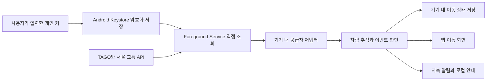

# NextStop 개발 명세

최초 작성일은 2026년 10월 2일이며, 10월 7일 Android 전용·백엔드 없는 구현으로 변경했습니다. 사용자가 앱에서 개인 API 키를 입력하고, 기기가 교통 API를 직접 조회합니다.

사용자는 현재 탑승한 버스 또는 지하철의 노선, 방향, 차량을 선택합니다. Android 앱이 해당 차량의 운행 상태를 추적하고, 앱과 시스템 알림에 현재 정류장 또는 이동 구간을 표시합니다. 확인된 지하철 역 도착과 버스 위치 기반 진행 안내를 구분해 제공합니다.

전국 서비스는 데이터 확보 지역부터 단계적으로 제공합니다. Android는 커스텀 지속 알림을 기본으로 사용합니다. 현재 직접 조회 구현은 TAGO 버스 제공 도시와 서울시 역정보의 지하철 19개 노선이며, iOS·백엔드·FCM·APNs는 현재 개발 범위에서 제외합니다.

아래의 기능, 자료구조, 수집 주기와 기술 구성은 개발 결정 또는 제안입니다. OS와 API의 제약은 해당 문단의 공식 출처를 근거로 합니다. 아직 인증키를 이용한 운행 실측이나 실제 기기 검증을 수행하지 않았습니다.

### 현재 개발 단계

`android/`에 Kotlin 네이티브 앱을 추가했습니다. 개인 키 등록·암호화 저장, 직접 API 조회, 차량 선택, 활성 이동 1개, Foreground Service, 커스텀 지속 알림과 로컬 도착·하차 안내를 구현합니다. 상세 범위와 실행 방법은 [Android 개발 안내](android.md)를 따릅니다.

기존 React 웹은 8개 예시 노선으로 화면과 흐름을 확인하는 미리보기로 유지합니다. 웹의 자동 진행·도착 기록은 실제 차량 정보와 연결되어 있지 않으며, Android의 개인 키를 공유하지 않습니다.

웹 실행·검증 방법은 [프론트엔드 개발 안내](frontend.md)에 있습니다. 아래 iOS와 서버 API 계약은 기존 확장 검토안으로만 보존하며 현재 앱의 필수 구성 요소가 아닙니다.

## 제품 목표와 MVP 범위

| 항목 | 초기 구현 범위 |
| --- | --- |
| 서비스 지역 | 대한민국 전국 검색을 목표로 데이터 확보 지역부터 제공 |
| 버스 | 개인 키로 TAGO 도시·노선·정차 순서·차량 위치를 조회하며, 서울·경기 별도 API는 후속 연동 |
| 지하철 | 서울시 역정보의 19개 노선 선택, 방향·행선지 경로를 확인할 수 있는 일반 열차 및 9호선 급행 추적, 2호선 지선 포함 |
| 탑승 차량 | 사용자가 후보 차량을 확인하고 지정 |
| 동시 추적 | 기기당 활성 탑승 세션 1개 |
| 진행 안내 | 현재 역·정류장 또는 이동 구간, 이전 3개와 다음 3개, 다음 정차 지점 |
| 도착 알림 | 모든 도착·진행 지점 안내, 하차 안내, 무음 갱신 중 선택; TAGO 버스는 위치 기반 안내 |
| 하차역 | 선택 항목이며, 다음 실제 정차 지점 중에서 지정 |
| 앱 외부 표시 | Android 지속 알림과 로컬 안내 알림 |
| 이용 방식 | 회원가입 없이 기기별 세션과 기기 내 즐겨찾기로 시작 |

첫 출시에서 고속·시외버스, 자동 환승 연결, GPS만으로 탑승 차량 확정, 객차별 위치 추적은 제공하지 않습니다. 자동 차량 인식과 다른 도시철도 운영기관의 실시간 연계는 후속 개발 범위입니다.

### 노선별 지원 상태

| 사용자 표시 | 제공할 기능 | 제공 조건 |
| --- | --- | --- |
| 실시간 차량 추적 | 특정 차량 위치·진행 상태와 확인된 도착 이벤트 | 차량 식별자, 정차 순서, 상태의 연속성이 검증됨 |
| 위치 기반 안내 | 사용자 위치에 따른 진행 추정 | 위치 권한과 해당 노선의 추정 기능이 구현됨 |
| 시간표 안내 | 정차 순서와 예정 시각 | 최신 시간표 확보 |
| 실시간 추적 미지원 | 노선 검색과 확보된 기본 정보 | 위치 또는 개별 차량 정보 없음 |

초기 출시에서는 실시간 차량 추적과 시간표 안내를 우선합니다. 위치 기반 안내는 검증 후 활성화하며, 상태 이름만 먼저 표시하지 않습니다. 시간표 안내에는 항상 ‘예상’ 문구를 사용하고 실제 도착 확인으로 취급하지 않습니다.

지원 상태는 노선 전체뿐 아니라 구간에도 적용합니다. 지원 구간을 벗어나면 기존 실시간 표시를 그대로 유지하지 않고 마지막 확인 시각과 미지원 상태를 표시합니다.

## 플랫폼별 알림 결정

### Android 알림

기본 구현은 같은 notification ID를 갱신하는 커스텀 지속 알림입니다. 접힌 알림과 헤드업 알림에는 노선, 방향, 현재 상태와 다음 정류장을 표시합니다. 펼친 알림에는 7개 정류장 노선도를 표시합니다.

`RemoteViews`로 커스텀 콘텐츠를 구현하되 시스템 헤더와 알림 틀을 유지합니다. Android 12 이상은 완전히 자유로운 알림 외형을 허용하지 않고, 사용 가능한 높이는 OS와 표시 상태에 따라 제한됩니다. 큰 글자와 작은 화면에서는 요약 레이아웃으로 전환합니다. [Android 커스텀 알림](https://developer.android.com/develop/ui/views/notifications/custom-notification)

Android 16 계열 이후의 지원 기기에서는 Live Updates를 추가 대안으로 제공합니다. `ProgressStyle`에 진행 지점과 현재·다음 정류장 텍스트를 배치합니다. Live Updates는 커스텀 `RemoteViews`를 허용하지 않으므로 커스텀 노선도와 하나의 알림으로 결합하지 않습니다. OS·제조사 조건과 사용자 설정을 확인해 지원되는 경우에만 활성화합니다. [Android Live Updates](https://developer.android.com/develop/ui/views/notifications/live-update)

초기 선택은 커스텀 지속 알림입니다. Live Updates 모드에서는 시스템 진행 표시로 대체하고, 같은 여정의 추적 카드를 두 개 동시에 게시하지 않습니다. 사용자가 카드를 닫으면 자동으로 다시 게시하지 않습니다. 명시적 추적 재개 시 다시 표시합니다.

알림 채널은 `ride_status`와 `ride_alerts`로 구분합니다. 전자는 소리 없이 진행 상태를 갱신하고, 후자는 확인된 도착과 하차 이벤트를 알립니다. 도착 알림은 누적을 제한하고 이벤트 ID로 중복을 제거합니다. 일반 배너를 화면 상단에 계속 고정하지 않습니다.

Android 13 이상은 알림 권한이 필요합니다. 알림 권한이 거부되어도 앱 내부 추적은 사용할 수 있고, 앱 외부 표시가 제한됨을 탑승 시작 전에 안내합니다. [Android 알림 권한](https://developer.android.com/develop/ui/compose/notifications/notification-permission)

알림 표시와 백그라운드 실행은 별개입니다. 사용자가 앱에서 추적을 시작하면 `dataSync` Foreground Service가 개인 키로 교통 API를 직접 조회합니다. 기본 간격은 30초이며 20·60초로 변경할 수 있습니다. 키 오류·호출 한도 초과 시 중단하고, 연결 실패 시 최대 120초로 간격을 늘립니다. FCM과 백엔드는 사용하지 않습니다.

앱의 최대 추적 시간은 4시간이며 강제 종료·재부팅 후 자동 재시작하지 않습니다. Android 15 이상 대상의 `dataSync`에는 백그라운드 실행 시간 제한이 있으므로 `onTimeout`에서 추적을 종료합니다. 네트워크·Doze·제조사 정책에 따른 갱신 지연은 실기기에서 검증합니다. [Foreground Service 유형](https://developer.android.com/develop/background-work/services/fgs/service-types), [실행 시간 제한](https://developer.android.com/develop/background-work/services/fgs/timeout)

### iOS 알림 후속 검토

기본 구현은 iOS 16.1 이상에서 ActivityKit으로 시작하는 Live Activity입니다. 잠금화면에 노선도와 현재 상태를 표시하고, Dynamic Island가 있는 기기에는 작은 표시와 확장 표시를 제공합니다. [Apple Live Activities 소개](https://developer.apple.com/kr/news/?id=ttuz9vwq)

일반 알림의 작은 배너는 시스템이 표시합니다. Notification Content Extension은 펼친 알림에 커스텀 UI를 제공할 수 있지만, 초기 MVP에서는 지속 진행 표시를 Live Activity로 통일하고 일반 배너는 도착 문구에 사용합니다. [Apple 알림 콘텐츠 확장](https://developer.apple.com/documentation/usernotificationsui/customizing-the-appearance-of-notifications)

사용자가 앱에서 추적을 시작하면 Live Activity를 생성하고 갱신 토큰을 서버에 등록합니다. 서버는 APNs의 ActivityKit 푸시로 해당 활동을 갱신·종료합니다. 토큰 변경을 서버에 반영하고 유효하지 않은 토큰은 제거합니다. 원격 활동 시작과 방송 채널은 초기 구현에서 제외합니다.

Live Activity 자체는 네트워크 조회와 위치 수신을 하지 못합니다. 활동은 최대 8시간 활성화되며 정적·동적 데이터 합계는 4KB 이내여야 합니다. 전체 노선을 보내지 않고 현재 주변 지점과 요약 상태만 전달합니다. [ActivityKit 제약](https://developer.apple.com/documentation/activitykit/displaying-live-data-with-live-activities?changes=_6)

푸시 갱신은 OS의 전송 예산과 사용자 설정에 영향을 받습니다. 중요도가 낮은 상태 갱신과 도착 알림의 우선순위를 구분하고, 잦은 갱신 설정을 사용해도 즉시 전송을 보장하지 않습니다. 일반 도착 배너와 ActivityKit의 alert를 동시에 발송하지 않도록 하나의 알림 경로를 선택합니다. [ActivityKit 푸시](https://developer.apple.com/documentation/activitykit/starting-and-updating-live-activities-with-activitykit-push-notifications)

Live Activities 허용 상태와 일반 알림 권한을 각각 확인합니다. 활동이 비활성화된 경우 일반 도착 알림으로, 일반 알림도 거부된 경우 앱 내부 표시로 전환합니다. 활동을 시작하거나 표시할 수 없는 상태를 사용자에게 알려야 합니다.

## 데이터 공급자와 차량 식별

### 공개 API 활용

| 공급자 | 확보 가능한 주요 정보 | 개발 적용 |
| --- | --- | --- |
| TAGO 버스 노선·위치 | 노선별 정류장, 정류소 순서, 차량번호, 위치 등 | 연계 도시 검색과 버스 추적 |
| 서울 버스 위치 | `vehId`, `plainNo`, `sectOrd`, `stopFlag`, `dataTm` 등 | 특정 차량 추적과 도착 상태 확인 |
| 경기 버스 API | 노선별 실시간 위치와 도착정보 조회 | 경기 지역 연동 |
| 서울 지하철 위치 | `trainNo`, `statnId`, `updnLine`, `trainSttus`, `recptnDt` 등 | 개별 운행 열차 추적 |
| 서울 지하철 도착 | `btrainNo`, `arvlCd`, `barvlDt`, `recptnDt` 등 | 열차 후보와 해당 열차의 도착정보 연결 |
| TAGO 지하철 | 역 목록, 출구, 시간표 | 전국 검색과 시간표 안내 |

근거: [TAGO 버스 노선](https://www.data.go.kr/data/15098529/openapi.do), [TAGO 버스 위치](https://www.data.go.kr/data/15098533/openapi.do), [서울 버스 위치](https://www.data.go.kr/data/15000332/openapi.do), [경기 API](https://www.gbis.go.kr/gbis2014/publicService.action?cmd=openApiInfo), [서울 열차 위치](https://data.seoul.go.kr/dataList/datasetView.do?infId=OA-12601&serviceKind=1&srvType=A), [서울 도착정보 명세](https://data.seoul.go.kr/dataList/openApiView.do?infId=OA-12764&srvType=A), [TAGO 지하철](https://www.data.go.kr/data/15098554/openapi.do).

TAGO를 전국 모든 노선의 완전한 실시간 데이터로 간주하지 않습니다. 실제 연계 도시와 응답 유무를 확인하고 공급자별 지원 목록을 관리합니다. 서울 API의 수도권 지하철 제공 범위도 노선별·역별로 검증합니다. 서울 도착정보 문서는 미제공 역 구간과 원천 데이터 지연을 명시합니다. [서울 도착정보 유의사항](https://data.seoul.go.kr/dataList/OA-12764/A/1/datasetView.do)

부산·대구에서 확인한 열차시각표 API와 TAGO 지하철 API만으로 실제 열차의 실시간 위치를 확정하지 않습니다. 다른 도시철도는 개별 차량 식별자가 있는 실시간 연계를 확보한 후 지원합니다. [부산 시각표 설명](https://www.data.go.kr/dataset/15000522/openapi.do%3Bjsessionid%3D3pDH-3KUkj6grzrvFmyKJMa5.node20?lang=en), [대구 시각표](https://www.data.go.kr/data/15133855/openapi.do)

### 버스 탑승 선택

사용자는 지역, 노선과 방향을 선택합니다. 앱은 차량 후보를 최근 확인 위치, 조회 시각, 차량번호로 표시합니다. 사용자가 탑승한 버스의 차량번호와 대조해 선택하면 기기에서 같은 차량을 추적하며, 선택 시 차량 위치를 탑승 지점으로 사용합니다.

내부 차량 키는 `provider + regionId + vehicleId`를 사용합니다. 공급자가 차량 ID 대신 번호판만 제공하면 정규화한 차량번호를 사용하되 해당 노선과 운행 세션을 함께 검증합니다. 끝자리만으로 중복 차량을 자동 확정하지 않습니다.

GPS는 주변 정류장과 차량 후보를 좁히는 선택 기능입니다. 위치 권한 없이도 수동 검색과 차량 선택이 가능해야 합니다. 비슷한 위치에 있는 버스가 여러 대라면 사용자 확인 없이 하나를 선택하지 않습니다.

버스 구간 순번이 출발·도착 정류장 중 어느 쪽을 뜻하는지는 공급자별 어댑터에서 실측으로 확정합니다. 도로 좌표와 정류장 좌표만으로 도착 여부를 단정하지 않습니다.

### 지하철 탑승 선택

사용자는 노선, 탑승역, 진행 방향과 행선지를 선택합니다. 앱은 탑승역에 도착·출발 중이거나 최근 출발한 열차를 후보로 제시합니다. 각 후보에는 행선지, 일반·급행 구분, 현재 상태, 데이터 기준 시각을 표시합니다.

내부 열차 키는 `provider + serviceDate + lineId + trainNo`를 사용하고 방향·행선지를 함께 검증합니다. 운행일 경계는 공급자의 운행 기준에 맞춰 처리하며, 단순히 자정에 진행 중 세션을 다른 열차로 연결하지 않습니다.

열차번호는 문자열로 보존합니다. 앞자리 0, 표기 형식 차이는 공급자 규칙에 따라 정규화합니다. `trainNo`와 `btrainNo`의 대응이 확인된 노선에서만 도착 예정 정보를 연결합니다. 객차번호나 물리적 편성번호를 운행 열차번호로 취급하지 않습니다.

추적 대상을 잃었을 때 비슷한 위치의 다른 열차로 자동 교체하지 않습니다. ‘열차 정보를 확인할 수 없어요’와 차량 재선택을 제공합니다. 지하 구간에서 스마트폰 GPS만으로 역 도착을 확정하지 않습니다.

### 노선과 정차 순서

정류장 ID만으로 진행 위치를 표현하지 않습니다. 같은 정류장을 반복 방문하는 노선과 순환 노선을 위해 정차 지점에 운행 경로 내 순번 `occurrenceIndex`를 부여합니다. 노선 검색 번호, 공급자의 노선 ID, 운행 방향, 지선·행선지를 구분합니다.

현재 Android 구현은 9호선 급행의 공식 16개 정차역을 지원합니다. 통과역의 위치 응답도 추적하되, 다음 정차역과 남은 역 수·하차 목록·도착 알림에는 실제 정차역만 반영합니다. 다른 노선의 급행·특급은 정차 패턴이 검증되기 전까지 후보에서 제외합니다. 정차 여부를 세션에 저장하며, 행선지나 일반/급행 구분이 바뀌면 차량을 다시 선택하도록 안내합니다. 향후 열차별 시간표를 연동할 때는 운행일·열차번호·노선 데이터 버전도 함께 검증합니다.

## 화면과 사용자 흐름

기본 흐름은 `홈과 검색 → 노선과 방향 선택 → 탑승 차량 확인 → 추적 시작 → 이동 중 → 하차 완료`입니다. 차량 변경은 기존 추적 종료와 새 탑승 선택으로 처리합니다.

| 화면 | 필수 콘텐츠와 동작 |
| --- | --- |
| 홈과 검색 | 지역 선택, 버스·지하철 탭, 노선·역 검색, 최근 선택, 즐겨찾기, 활성 세션 복귀 |
| 노선과 방향 | 노선명, 종착지 또는 다음 주요 역으로 표현한 방향, 탑승 지점, 지원 상태 |
| 탑승 차량 확인 | 차량 후보, 차량번호 또는 열차 행선지, 일반·급행, 현재 위치, 기준 시각, 선택 버튼 |
| 추적 시작 | 선택 차량 요약, 선택적 하차역, 알림 방식, 권한·지원 상태, 시작 버튼 |
| 이동 중 | 현재 상태, 가로 노선도, 다음 정차 지점, 하차까지 남은 지점 수, 마지막 확인 시각, 차량 변경과 종료 |
| 알림 설정 | 모든 도착 알림, 하차 알림, 무음 갱신, 소리·진동, OS별 미리보기 |

하차 알림 모드는 하차역 선택을 요구합니다. 선택하지 않은 경우 추적 시작 시 하차역을 지정하거나 무음·모든 도착 모드로 바꿀 수 있습니다. 모든 도착 모드의 선택적 하차 알림과 같은 이벤트는 한 번만 알립니다.

권한은 해당 기능을 시작할 때 요청합니다. 알림 권한은 추적 시작 또는 알림 활성화 시, 위치 권한은 주변 정류장·역 찾기를 사용했을 때 요청합니다. 실시간 데이터 기반 추적에 상시 사용자 위치 권한을 필수로 요구하지 않습니다.

이동 중 화면에서 알림을 탭하면 현재 활성 세션으로 이동합니다. 종료된 세션의 링크는 ‘종료된 이동입니다’와 새 이동 시작을 표시합니다. 상세 레이아웃과 색상은 [UI 디자인 시스템](design-system.md)을 따릅니다.

## 진행 상태와 도착 이벤트

### 상태 모델

세션의 수명 상태 `lifecycle`은 `active`, `ended`를 사용합니다. 진행 상태 `motion`은 `approaching`, `arrived`, `between`, `departed`, `unknown`을 사용합니다. 데이터 품질 상태 `freshness`는 `fresh`, `stale`, `lost`, `unsupported`를 사용합니다. 수명, 움직임, 품질을 분리해 마지막 도착 위치를 보존하면서도 갱신 지연을 표현합니다.

| 상태 | 사용자 문구 예시 | 도착 이벤트 |
| --- | --- | --- |
| approaching | 강남역에 진입 중 | 생성하지 않음 |
| arrived | 강남역 도착 확인 | 해당 정차 지점에 최초 확인 시 생성 |
| between | 교대역 → 강남역 이동 중 | 생성하지 않음 |
| departed | 강남역 출발 | 출발만 확인된 경우 도착으로 바꾸지 않음 |
| unknown | 현재 위치 확인 중 | 생성하지 않음 |
| stale | 갱신 지연 · 마지막 확인 강남역 | 새로운 도착 이벤트를 생성하지 않음 |
| lost | 차량 정보를 확인할 수 없어요 | 재선택 제공 |
| unsupported | 이 구간은 실시간 추적을 지원하지 않아요 | 실제 도착 이벤트 생성 중단 |

공급자별 원천 상태를 정규화합니다. 서울 버스의 `stopFlag`와 서울 지하철의 `trainSttus`·`arvlCd`는 각 필드가 가리키는 지점과 상태를 확인한 후 매핑합니다. 특히 ‘전역 출발’을 조회 대상 역 도착으로 처리하지 않습니다.

### 도착 판단 순서

1. 선택 차량과 운행 세션의 일치 여부를 검증합니다.
2. 원천 데이터 시각을 비교하고 이전보다 오래된 응답을 버립니다.
3. 원천 상태와 정차 순서를 매핑해 현재 지점 또는 구간을 계산합니다.
4. 명시적 도착 상태가 유효하면 `arrival_confirmed` 이벤트를 생성합니다.
5. 도착 상태를 놓친 채 다음 구간으로 진행했다면 `passage_observed` 또는 추정 상태만 기록합니다.
6. 최신 상태를 저장하고 구독 기기의 추적 표시를 갱신합니다.
7. 알림 설정과 이벤트 유효시간을 확인한 뒤 사용자 알림을 전송합니다.

확인된 도착과 진행 추정은 별도 근거로 저장합니다. 시간표 보간과 GPS 추정으로 ‘도착 확인’ 알림을 생성하지 않습니다. 지나간 여러 역의 도착 알림을 뒤늦게 연속 발송하지 않습니다.

이벤트 중복 키는 `sessionId + journeyEpoch + occurrenceIndex + eventType`입니다. 순환 운행의 반복 방문은 새로운 occurrenceIndex 또는 journeyEpoch로 구분합니다. 푸시 재전송과 기기 처리에서도 같은 eventId를 사용합니다.

알림 모드는 다음과 같습니다.

| 모드 | 사용자에게 알리는 이벤트 |
| --- | --- |
| all_stops | 확인된 지하철 역 도착, TAGO 버스의 위치 기반 진행 지점 변경 |
| alight_only | 하차 지점 직전 안내, 확인된 지하철 하차역 도착 또는 버스 하차 정류장 부근 안내 |
| silent | 진행 표시만 갱신 |

하차역이 다음 정차 지점이 되었는데 도착 이벤트를 놓친 경우에도 ‘다음은 하차역입니다’는 진행 상태를 근거로 보낼 수 있습니다. 이 문구를 실제 하차역 도착 확인으로 대체하지 않습니다.

지하철의 하차 전 안내는 직전 역 출발 상태를, 버스는 직전 진행 지점의 위치 응답을 기준으로 합니다. 도착과 출발은 서로 다른 관측으로 처리합니다. 오래된 응답이나 건너뛴 지점의 도착 알림을 뒤늦게 만들지 않습니다.

### 데이터 시각과 지연

사용자에게 지하철의 원천 데이터 시각을 ‘데이터 기준’으로 표시합니다. 원천 관측 시각이 없는 TAGO 버스 위치 응답은 ‘조회 시각’으로 표시하며 원천 데이터가 최신임을 단정하지 않습니다.

조회 간격은 기본 30초이고 20·60초 선택을 지원합니다. 지연 판단의 기준은 90초이며 공급자별 정상 갱신 주기를 실측한 뒤 조정합니다.

지하철은 요청이 성공해도 원천 데이터 시각이 오래되면 지연 상태를 표시합니다. 네트워크 실패 시 마지막 위치를 보존하고 연결 지연을 표시합니다. Android가 실행을 중단하면 알림의 자동 갱신도 멈출 수 있으므로 마지막 시각을 항상 유지합니다.

## Android 직접 조회 구조

현재 앱은 Kotlin과 Android 기본 View, 플랫폼 HTTP 연결, Android Keystore와 기기 내 저장소를 사용합니다. 서버·데이터베이스·공유 캐시·작업 큐를 운영하지 않습니다.



화면이 보이는 동안과 백그라운드에서 같은 Foreground Service의 상태를 사용합니다. 지속 알림은 같은 notification ID로 갱신하며, 이벤트 안내는 별도 채널에서 발송합니다. 알림을 통해 서비스가 무조건 계속 실행되는 것은 아닙니다.

공급자 API의 인증키는 사용자가 직접 등록·변경·삭제합니다. Keystore의 AES-GCM 키로 암호화해 앱 전용 저장소에 보관하고 백업·기기 이전에서 제외합니다. 앱 번들·이동 상태·로그·분석 서비스에 키를 넣지 않습니다. 각 사용자의 요청은 해당 개인 키의 한도를 사용하며 기기 간 조회를 공유하지 않습니다.

도착 예정시간은 선택 차량과 연결할 수 있을 때만 표시합니다. 정류장에 오는 첫 번째 버스의 ETA를 이미 선택한 탑승 차량의 ETA로 사용하지 않습니다. 차량 식별자가 없는 도착정보는 일반 정류장 안내로만 사용합니다.

기본 30초 조회는 이동 위치 조회에 시간당 약 120회를 사용합니다. 노선 검색·정차 순서·연결 확인과 페이지 조회는 추가 호출입니다. API별 한도를 초과하면 추적을 중단하고 사용자가 개인 키와 사용량을 확인하도록 안내합니다.

기기당 활성 이동 1개만 조회하고 하차 완료 시 서비스를 종료합니다. 차량 변경 전 작업의 늦은 응답이 새 이동을 덮어쓰지 않도록 세션 ID와 서비스 작업 세대를 확인합니다. 공급자 장애 시 마지막 확인 시각과 위치를 보존합니다.

## 내부 데이터와 API 계약

아래 서버 모델과 `/v1` 엔드포인트는 향후 서버가 필요한 경우의 검토안입니다. 현재 Android 앱은 이 엔드포인트를 호출하지 않고 공급자 API와 기기 내 모델을 사용합니다. 구현된 모델과 저장 형태는 [Android 개발 안내](android.md)에 있습니다.

### 주요 모델

| 모델 | 핵심 필드 |
| --- | --- |
| Region | id, name, provider, enabled |
| RoutePattern | id, regionId, mode, lineId, directionLabel, destination, serviceType, version, orderedStops, capabilityBySegment |
| StopOccurrence | stopId, name, occurrenceIndex, optionalCoordinates |
| VehicleCandidate | candidateId, providerVehicleKey, routePatternId, displayLabel, sourceObservedAt, fetchedAt, expiresAt |
| RideSession | id, deviceId, routePatternId, routeVersion, vehicleKey, serviceDate, lifecycle, alightOccurrenceIndex, notificationMode |
| RideState | sessionId, revision, motion, freshness, evidence, currentOccurrenceIndex, between, previousStops, upcomingStops, timestamps |
| RideEvent | eventId, sessionId, eventType, occurrenceIndex, evidence, observedAt, expiresAt, deliveryState |
| DeviceSubscription | deviceId, platform, pushToken, activityId, activityPushToken, capabilities, expiresAt |

`evidence`는 `provider_confirmed`, `provider_progress`, `gps_estimated`, `schedule_estimated`, `unknown` 중 하나입니다. 전체 응답에 모델을 무조건 노출하지 않고 필요한 필드만 반환합니다. 푸시 토큰은 앱 화면과 운영 로그에 출력하지 않습니다.

API 내부 시각은 UTC ISO 8601 문자열을 사용합니다. 서비스 운행일과 사용자 표시 시각은 한국 표준시와 공급자 운행일 규칙으로 계산합니다. 역·정류장·차량번호는 숫자로 강제 변환하지 않습니다.

### HTTP 엔드포인트

아래 경로는 앱 자체 서버의 계약이며 교통 공급자 API 경로가 아닙니다.

| 메서드와 경로 | 역할 |
| --- | --- |
| GET /v1/regions | 제공 지역과 활성 지원 목록 |
| GET /v1/routes?regionId=...&mode=...&query=... | 지역별 노선 검색 |
| GET /v1/stops?regionId=...&mode=...&query=... | 정류장과 역 검색 |
| GET /v1/routes/{routeId}/patterns | 방향·행선지·급행별 정차 경로와 지원 구간 |
| GET /v1/patterns/{patternId}/vehicles?boardingOccurrenceIndex=... | 탑승 지점 주변 차량 후보 |
| POST /v1/ride-sessions | 후보 재검증 후 탑승 추적 시작 |
| GET /v1/ride-sessions/{sessionId} | 현재 상태와 주변 정차 지점 |
| PATCH /v1/ride-sessions/{sessionId}/preferences | 하차역과 알림 모드 변경 |
| POST /v1/ride-sessions/{sessionId}/end | 추적 종료와 활동 종료 작업 생성 |
| PUT /v1/devices/{deviceId}/push-subscription | 기기 푸시 등록과 갱신 |
| PUT /v1/ride-sessions/{sessionId}/live-activity | iOS 활동 ID와 갱신 토큰 등록 |

세션 생성과 종료는 멱등성을 지원합니다. 오래된 candidateId로 시작하면 재선택을 요청합니다. 새 탑승이 시작되면 기존 활성 세션을 종료하고 기기에는 새 sessionId를 반영합니다. 앱 재실행 시 서버의 활성 세션을 복구합니다.

세션 접근은 기기별 자격 증명으로 제한합니다. sessionId를 아는 것만으로 다른 기기의 이동 상태를 조회하거나 종료할 수 없어야 합니다. iOS 활동 토큰도 세션 소유자를 검증한 뒤 연결합니다.

### 상태 응답 예시

다음은 형식 설명을 위한 가상 세션입니다. 실제 공급자 응답이나 현재 운행 정보가 아닙니다.

```json
{
  "sessionId": "ride_example",
  "revision": 24,
  "lifecycle": "active",
  "routeName": "2호선",
  "directionLabel": "역삼·잠실 방면",
  "motion": "arrived",
  "freshness": "fresh",
  "evidence": "provider_confirmed",
  "currentStop": {"name": "강남", "occurrenceIndex": 10},
  "previousStops": ["방배", "서초", "교대"],
  "upcomingStops": ["역삼", "선릉", "삼성"],
  "alightStop": "삼성",
  "remainingStops": 3,
  "sourceObservedAt": "2026-10-02T05:32:10Z",
  "fetchedAt": "2026-10-02T05:32:14Z",
  "updatedAt": "2026-10-02T05:32:15Z"
}
```

도착 상태에서 `previousStops`는 현재 지점 이전, `upcomingStops`는 현재 지점 이후의 실제 정차 지점입니다. 이동 중에는 `currentStop`을 비우고 `between`에 출발 지점과 다음 정차 지점을 저장합니다.

## 갱신과 종료 처리

Android 앱과 서비스는 세션 ID, 작업 세대와 관측 시각을 비교해 종료된 세션과 오래된 응답을 버립니다. iOS Live Activity의 timestamp·APNs 순서 제어는 후속 플랫폼 검토 항목입니다.

하차역 도착만으로 사용자가 실제 하차했다고 확정하지 않습니다. ‘하차 완료’ 버튼으로 즉시 종료하고, 무응답 세션은 설정한 시간 제한과 종점·운행 종료 상태에 따라 정리합니다. 초기 최대 추적 시간 제안은 4시간이며, 사용자가 다시 시작할 수 있습니다. 이 값은 iOS의 8시간 시스템 제한과 별개인 제품 결정입니다.

사용자 종료와 차량 변경 이후 늦게 끝난 조회는 이전 알림을 다시 게시하지 않습니다. 서비스가 종료되면 지속 알림을 제거합니다. 앱 강제 종료·프로세스 소실 후에는 사용자가 추적 재개 또는 차량 재선택을 해야 하며, 새 차량으로 자동 연결하지 않습니다.

배터리 절약, 네트워크 차단, 앱 강제 종료와 사용자 알림 설정 때문에 표시 갱신이나 배너가 지연·누락될 수 있습니다. 상태 시각과 지연 문구를 유지하고, ‘모든 도착을 즉시 보장’하는 제품 문구를 사용하지 않습니다.

## 구현 순서와 검증 기준

| 단계 | 작업과 완료 조건 |
| --- | --- |
| 데이터 검증 | 인증키 확보, 대표 노선 운행 샘플 수집, ID 연속성·방향·정차 순서·지연·누락 측정, 지원 목록 확정 |
| 기기 내 추적 | 개인 키, 공급자 어댑터, 직접 조회, 상태 모델, 중복 없는 이벤트와 세션 수명 구현 |
| 앱 기본 흐름 | 검색, 방향, 차량 선택, 추적 화면, 종료, 데이터 품질 상태와 디자인 토큰 적용 |
| 시스템 표시 | Android 커스텀 지속 알림, 로컬 안내, 권한 거부와 큰 글자 요약 처리 |
| 실제 기기 검증 | 잠금화면·백그라운드·Doze·집중 모드·네트워크 단절에서 관측 결과 기록 |
| 제공 범위 확장 | TAGO 도시와 지하철 노선별 검증을 통과한 항목만 활성화 |

출시 전에 확인할 동작은 다음과 같습니다.

- 같은 도착 응답을 반복 수신하거나 푸시를 재시도해도 하나의 도착 이벤트만 생성한다.
- 이전 시각의 응답, 다른 차량, 오래된 후보가 현재 추적을 덮어쓰지 않는다.
- 도착을 놓친 상태와 시간표 예상 위치를 실제 도착으로 알리지 않는다.
- 순환 노선, 동일 정류장 반복, 급행, 지선과 종점에서 다음 정차 지점이 정확하다.
- 각 기기의 요청은 사용자가 등록한 개인 키를 사용하고, 활성 이동 종료 후 추가 조회를 중단한다.
- 알림 권한이 없어도 노선 검색은 동작하며, 지속 알림을 위한 추적 시작 전에 권한을 안내한다.
- 세션 종료·차량 변경 후 늦은 푸시로 이전 추적 표시가 되살아나지 않는다.
- 실제 기기에서 긴 역명과 큰 글자 설정에 대해 현재 상태·다음 정차 지점·지연 문구를 읽을 수 있다.
- 개인 키는 로그·이동 상태·백업·기기 이전에 포함되지 않으며, 삭제 후 해당 키를 사용하는 추적을 종료한다.

단위 검증은 어댑터 정규화, 정차 순서, 상태 전이, 중복 제거와 멱등성처럼 오류가 사용자 알림에 영향을 주는 로직에 집중합니다. 통합 검증은 API 기록 재생으로 정상·지연·누락·순서 역전 응답을 재현합니다. UI와 실제 푸시 수신은 시뮬레이터뿐 아니라 Pixel·Galaxy와 Dynamic Island 유무가 다른 iPhone에서 검증합니다.

측정 항목은 원천 데이터 나이, 기기 조회 지연, 확인 가능한 도착 이벤트 누락률, 중복 안내 수, 실제 표시 지연, 개인 키의 호출량과 배터리 사용입니다. API 성공을 모든 정류장의 정확한 도착 확인으로 간주하지 않습니다. 도착 안내 누락률과 지원 판정 기준의 수치는 실측 후 확정합니다.

출시 전 남은 핵심 결정은 전국 공급자별 실제 제공 범위, API 한도 확대, 서울 열차번호 매칭, Android 백그라운드 갱신 방식의 실측 결과입니다. 이 항목이 검증되기 전에는 전체 전국 실시간 추적을 출시 기능으로 표시하지 않습니다.
